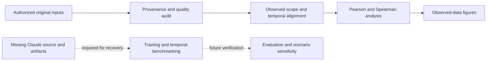

# QuanAra

**Quantitative AI for Aviation & Tourism**

QuanAra investigates how aviation activity relates to hospitality demand in Abu Dhabi, with an emphasis on observed evidence, temporal validation and reproducible forecasting research.


[Recovery status](docs/recovery-status.md) · [Methodology](docs/methodology.md) · [Reproducibility](docs/reproducibility.md) · [Future research](docs/roadmap.md)

## Research challenge and current capabilities

Prepared for the **DCT Abu Dhabi ChallengeON 2026** research context described by the project owner. The objective is to connect aviation supply and passenger activity with clearly defined hospitality targets, and eventually benchmark forecasting models under comparable chronological evaluation.

The repository currently provides a reproducible offline competition-input audit and exploratory observed-data analysis. The complete Claude application, ten pages, trained models, predictions, simulator, copilot and Judges' Demo were not supplied and are **not recovered**. This repository is not yet a complete competition application. See the [source inventory and missing components](docs/recovery-status.md).

## Datasets and integrity

The competition inputs consist of four domestic/international hotel train/test workbooks, one flight workbook and a data dictionary. Originals remain private and unchanged. The audit checks file hashes, columns, types, dates, targets, missing values, suppression, duplicates, candidate keys, coverage and consistency.

The test workbooks lack `Guests`, so their outcomes cannot be evaluated. Departure country is not guest nationality; total passengers are not point-to-point passengers; guests are not new arrivals or automatically guest nights. The flight workbook's actual dated records differ from the dictionary's blanket monthly description. [Definitions and audit procedures](docs/methodology.md) explain these distinctions.

## Scientific workflow



## Feature engineering, correlations and visualizations

The original feature-engineering pipeline is unavailable. The [feature inventory](docs/results/feature_inventory.csv) has a schema and no invented model features. The new analysis reports every eligible observed numeric hotel variable within its scope and monthly reported count/capacity aviation variables. It preserves missingness, excludes constant series, records valid sample counts and never evaluates unlabelled outcomes.

Generated Pearson/Spearman tables, heatmaps, observed trends, feature–target scatter plots, distributions and missing-data figures remain local pending permission to redistribute competition-derived outputs. No experimental correlations are claimed in this README before publication approval. [Methodology](docs/methodology.md) explains temporal dependence, incomplete coverage, contemporaneous leakage and why association does not establish causation.

## Training, benchmarking and diagnostics

No model registry, training code, artifact or prediction records were provided. The [benchmark table](docs/results/model_benchmarking.csv) is header-only. No MAE, RMSE, WMAPE, R², model ranking, active model, training procedure, residual plot or generalization result can be verified. Models were not silently retrained.

## What-if Simulator, AI Copilot and Judges' Demo

These implementations are missing. Source-market controls, forecasting month, seat/frequency/load-factor/P2P scenarios, baseline and scenario outputs, model eligibility, zero-change checks and a saved-model worked example remain blocked. No live Python inference or precomputed demo is represented as working. Copilot behavior and a Judges' Demo reference model require original source and artifacts.

## Findings, limitations and future research

The verified engineering finding is that available repositories do not contain the requested application. The input audit also identifies discrepancies between dictionary descriptions and actual workbook availability/granularity. Statistical findings and competition-derived figures are held locally for review. Model-based research conclusions remain unavailable.

Future directions include AI-assisted forecast benchmarking, weather-aware forecasting, events and seasonal intelligence, and uncertainty-aware decision support. Each direction is explicitly proposed, with a [scientific motivation and validation strategy](docs/roadmap.md).

## Installation and reproducibility

```bash
python3 -m venv .venv
.venv/bin/python -m pip install -r requirements.txt
.venv/bin/python -m unittest discover -s tests -v
.venv/bin/python scripts/audit_inputs.py --inputs /path/to/authorized-inputs --output private-results
```

See [input filenames, generated outputs and recovery prerequisites](docs/reproducibility.md). There is no application startup command until its source is supplied.

## Project structure

```text
scripts/audit_inputs.py       Reproducible offline analysis
tests/test_analysis.py       Numerical behavior tests
docs/                       Recovery, methodology and reproducibility
docs/results/               Empty schemas for unavailable model records
requirements.txt            Tested dependency versions
QUANARA.png                 Preserved legacy image; not official QuanAra branding
```

[Validation report](docs/validation.md) records executed checks and distinguishes blocked application checks. Publication of original data, model binaries and derived competition outputs requires confirmed authorization.
