<p align="center"></p>

# QuanAra

**Quantitative AI for Aviation & Tourism** · DCT Abu Dhabi ChallengeON 2026

QuanAra is a research-driven predictive intelligence platform that connects aviation dynamics with hospitality demand through rigorous machine learning benchmarking, temporal validation, and model-based forecasting. Beyond predictive accuracy, the platform investigates model sensitivity, scenario-dependent responses, and predictive limitations, translating the complexity of real-world forecasting into transparent, measurable, and actionable intelligence for destination planning.

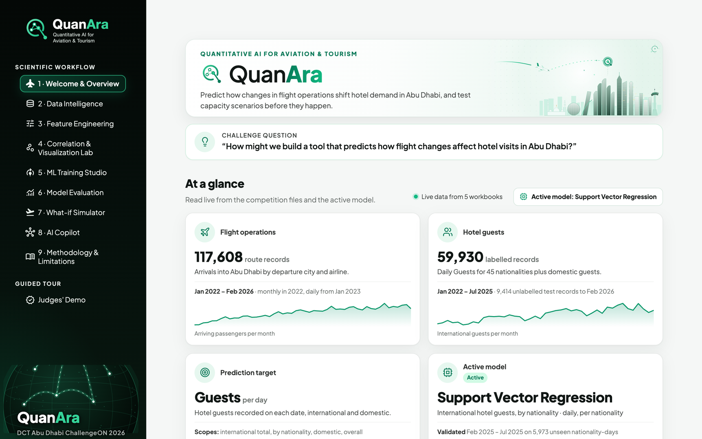

---

## Table of contents

- [Team](#team)
- [The research challenge](#the-research-challenge)
- [Contents](#contents)
- [Datasets](#datasets)
- [Scientific workflow](#scientific-workflow)
- [Feature engineering](#feature-engineering)
- [Correlation results (preliminary — ongoing investigation)](#correlation-results-preliminary--ongoing-investigation)
- [Model training and benchmarking](#model-training-and-benchmarking)
- [Machine learning models](#machine-learning-models)
- [The What-if Simulator](#the-what-if-simulator)
- [Application pages](#application-pages)
- [Figures](#figures)
- [Scientific limitations](#scientific-limitations)
- [Future research](#future-research)
- [Repository structure](#repository-structure)
- [Installation and execution](#installation-and-execution)
- [Reproducibility notes](#reproducibility-notes)

## Team

Amna Hamad · Thuraya Alremeithi · Rashed Alremeithi · Salem Jouban

## The research challenge

> *How might we build a tool that predicts how flight changes affect hotel visits in Abu Dhabi?*

QuanAra learns how daily arrivals into Abu Dhabi (AUH) relate to the number of hotel guests, validates that relationship on months the models never saw, and re-predicts guests when aviation inputs change. The relationships are **associations learned from historical data**. A scenario result is the model's prediction when aviation inputs change and everything else is held fixed — useful for planning and stress-testing, not proof of what a route change would cause.

## Contents

| Folder | What it holds |
|---|---|
| `app.py`, `quanara/` | The Streamlit application and its scientific core (data loading, cleaning, integration, features, models, training, evaluation, scenarios, Copilot) |
| `quanara/ui/` | The nine pages and the Judges' Demo (see *Application pages* below) |
| `data/` | How to place the six competition files, their checksums and column schemas — **no data is included** |
| `features/` | Feature definitions (`feature_definitions.csv`), matrix builder and executable feature checks |
| `models/` | One folder per trained algorithm with `train.py`, `predict.py`, `evaluate.py`, `config.json` and a README; `model_registry.csv` lists all 34 saved models |
| `analysis/` | Pearson, Spearman, heatmaps, scatter plots and statistical diagnostics |
| `evaluation/` | Metric recomputation, like-for-like model comparison and residual diagnostics |
| `simulator/` | Command-line What-if engine and its validation |
| `results/`, `figures/` | Outputs of the scripts above (aggregate statistics and charts only) |
| `docs/` | Methodology, feature engineering, model training, correlation analysis, scientific limitations, screenshots |
| `reports/` | Data audit, field dictionary, dataset build log and the independent page verification |
| `scripts/` | Dataset build, audit, reference-model training, page verification and documentation generation |
| `tests/` | 118 automated tests |

## Datasets

Only the six files supplied by the competition are used — no external data, calendars or APIs. They are **not** distributed here; see [`data/README.md`](data/README.md) for file names, checksums and placement.

| Dataset | Rows | Coverage |
|---|---|---|
| International hotel guests — train | 58,622 | 2022-01-01 → 2025-07-31, 45 nationalities |
| International hotel guests — test (no Guests) | 9,202 | 2025-08-01 → 2026-02-28 |
| Domestic hotel guests — train | 1,308 | 2022-01-01 → 2025-07-31 |
| Domestic hotel guests — test (no Guests) | 212 | 2025-08-01 → 2026-02-28 |
| Flight operations into AUH | 117,608 | monthly in 2022 (1,213 rows), daily from 2023-01-01 (116,395 rows) to 2026-02-28 |
| Data_Dictionary.pdf | — | field definitions, quoted field by field in the app |

## Scientific workflow

1. **Audit and integrate** the five workbooks (`quanara/data_loading.py`, `cleaning.py`, `integration.py`, `audit.py`). Blank cells stay missing; daily flights are decoded exactly from Average Weekly Frequency; the 2022 monthly flight rows are never split into days.
2. **Engineer features** on a complete daily calendar (`quanara/features.py`): same-day, trailing 7- and 28-day aviation sums, previous-week values, shares and growth recomputed from sums, calendar terms, and guests on the same weekday 364 days earlier. Details: [`docs/feature_engineering.md`](docs/feature_engineering.md).
3. **Explore correlations** with autocorrelation-aware statistics (`quanara/correlation.py`, `analysis/`).
4. **Train and validate chronologically** (`quanara/training.py`): fit on 2023-03-01 → 2025-01-31, score on the unseen holdout 2025-02-01 → 2025-07-31 (181 days), with expanding-window cross-validation before it; refit on all modelling days for deployment.
5. **Simulate** aviation changes with the saved pipelines (`quanara/scenario.py`, `simulator/`).

Modelling window: 2023-03-01 → 2025-07-31 (884 days, after a 56-day feature warm-up). Random splits are never used.

## Feature engineering

39 features in six groups — aviation (14), derived ratios and growth (10), calendar (7), last-year guests (4), market identifier (1) and same-day hotel observations (3, Competition mode only). Each one is documented with its source column, formula, time window, aggregation, missing-value handling, leakage assessment and the function that computes it in [`features/feature_definitions.csv`](features/feature_definitions.csv) and [`docs/feature_engineering.md`](docs/feature_engineering.md). Trailing windows include the current day (t−6 … t); `features/feature_validation.py` recomputes them from the raw route-day rows.

## Correlation results (preliminary — ongoing investigation)

Observed days 2023-03-01 → 2025-07-31 (n = 884). Full tables for every eligible feature, with valid n, p-values, effective n and differenced correlations, are in `results/correlations/`; discussion in [`docs/correlation_analysis.md`](docs/correlation_analysis.md).

| Relationship | Kind | Pearson r | Spearman ρ |
|---|---|---|---|
| Total P2P (trailing 7 days) → international guests | feature → target | 0.784 | 0.785 |
| Guests same weekday last year (7-day mean) → international guests | feature → target | 0.850 | 0.851 |
| Total P2P (trailing 7 days), day-over-day changes → international guests | feature → target | 0.191 | — |
| Flights vs seats | feature ↔ feature, observed | 0.995 | 0.994 |
| P2P share vs transfer share | feature ↔ feature, accounting identity | −1.000 | — |
| Weekend indicator → international guests | feature → target, weak | −0.052 | −0.049 |

Consecutive days are strongly autocorrelated (lag-1 ≈ 0.99), so the effective sample behind the P2P correlation is about 12 independent days, not 884, and the drop from 0.784 to 0.191 after differencing shows that much of the association is shared trend and season.

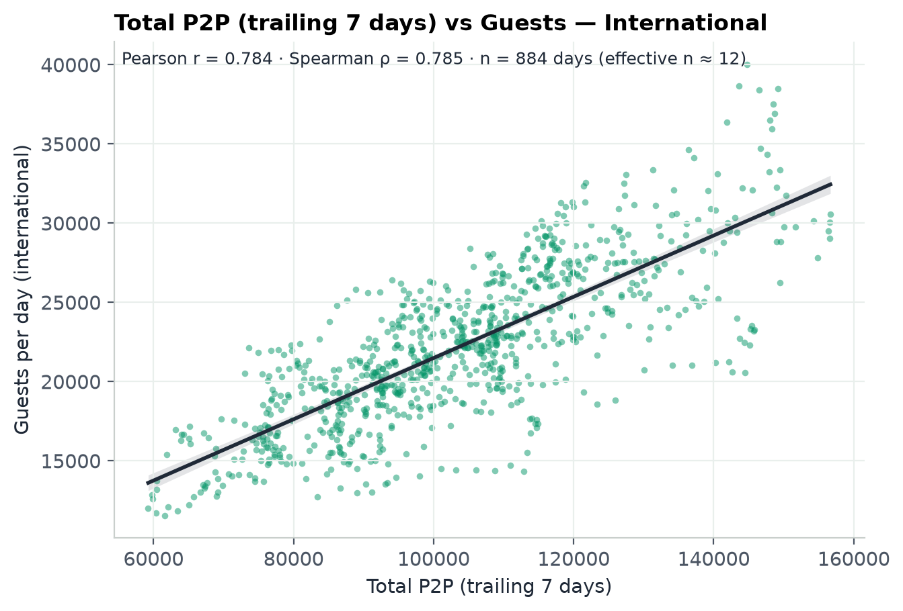

## Model training and benchmarking

Six algorithms have saved models: **CatBoost, Random Forest, XGBoost, Ridge Regression, Support Vector Regression (RBF) and the seasonal-naive baseline** (Guests on the same weekday last year). Extra Trees is implemented but has no saved model. Each saved model records its features, hyperparameters, dates, preprocessing, seed, software versions and metrics — see [`models/`](models/README.md) and [`docs/model_training.md`](docs/model_training.md).

Models are compared **only within the same target, grain and evaluation rows**, What-if and Competition apart. Holdout 2025-02-01 → 2025-07-31, What-if models (recomputed from the saved predictions by `evaluation/evaluate_models.py`):

| Target | Best What-if model | MAE | RMSE | R² | WMAPE | Seasonal baseline WMAPE |
|---|---|---|---|---|---|---|
| International guests, by nationality (per nationality-day) | CatBoost (reference) | 160.1 | 317.1 | 0.879 | 22.6% | 27.2% |
| International guests (daily total) | Random Forest | 1,662.3 | 2,077.3 | 0.706 | 6.7% | 12.4% |
| All guests (daily total) | Ridge Regression (reference) | 3,451.0 | 4,831.6 | 0.294 | 8.4% | 10.6% |
| Domestic guests (daily total) | Ridge Regression (reference) | 2,143.5 | 3,311.4 | 0.290 | 13.5% | 16.5% |

The full ranking is in `results/model_benchmarks/ranking_by_group.csv`. MAE and RMSE are in the target's own unit, so they are not comparable across rows.

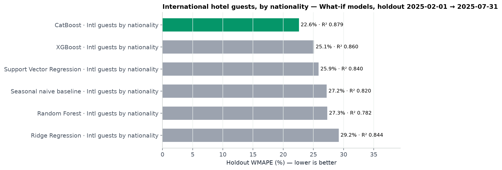

## Machine learning models

The six trained algorithm families recorded in the supplied registry are listed below. Metrics remain in the original benchmark table and the [like-for-like ranking](results/model_benchmarks/ranking_by_group.csv); compare only the same prediction target, granularity, mode and holdout period.

| Algorithm | Workflow folder | Role |
|---|---|---|
| CatBoost | [CatBoost](models/catboost/) | Lowest error at nationality level in the reported What-if comparison; Judges' Demo reference model |
| Random Forest | [Random Forest](models/random_forest/) | Reported best What-if model for international daily totals |
| XGBoost | [XGBoost](models/xgboost/) | Trained benchmark family; see its documented configurations and comparison groups |
| Ridge Regression | [Ridge Regression](models/ridge/) | Reported reference for domestic and all-guest daily totals |
| Support Vector Regression (RBF) | [Support Vector Regression](models/support_vector_regression/) | Active model used by the live What-if Simulator |
| Seasonal naive baseline | [Seasonal naive baseline](models/seasonal_naive/) | Same-weekday-last-year baseline for within-target comparison |

## The What-if Simulator

The live Simulator uses the **active model**, currently *Support Vector Regression · international guests by nationality* (holdout WMAPE 25.9%, R² 0.840). The CatBoost by-nationality reference model (WMAPE 22.6%) drives the Judges' Demo. 16 of the 34 saved models can drive scenarios; the rest are excluded for a stated reason (Competition mode, the seasonal baseline, or negative saved predictions).

How a scenario is computed (`quanara/scenario.py`):

1. choose the source market (departure country, or all) and the period;
2. change seat capacity, flight frequency, load factor or P2P share;
3. the route-day rows are modified (sustained over the 56-day feature look-back): PAX = load factor × seats, P2P = P2P share × PAX, transit scales with PAX, transfer = PAX − P2P − transit; six consistency checks run on every changed row;
4. every feature is rebuilt with the training code and the saved deployment pipeline predicts baseline and scenario on identical dates.

**Verified example** (`python simulator/scenario_engine.py --market "RUSSIAN FEDERATION" --month 2025-09 --seats 20`): Russian Federation nationality guests, September 2025, seats +20% (same aircraft size) — baseline **2,085.0**, scenario **2,191.4** guests per day, **+106.4 per day (+5.10%)**, +3,191 guest-days. With the CatBoost reference model the same scenario gives 1,732.2 → 1,806.5 (+4.29%); the two models agree on the direction and differ on the size, which is part of the honest answer.

`simulator/scenario_validation.py` confirms that a zero change reproduces the baseline for all 16 simulator-ready models, that the Judges' Demo reproduces its saved result, and that a +20% seat change moves seats, flights, PAX and P2P by exactly +20%.

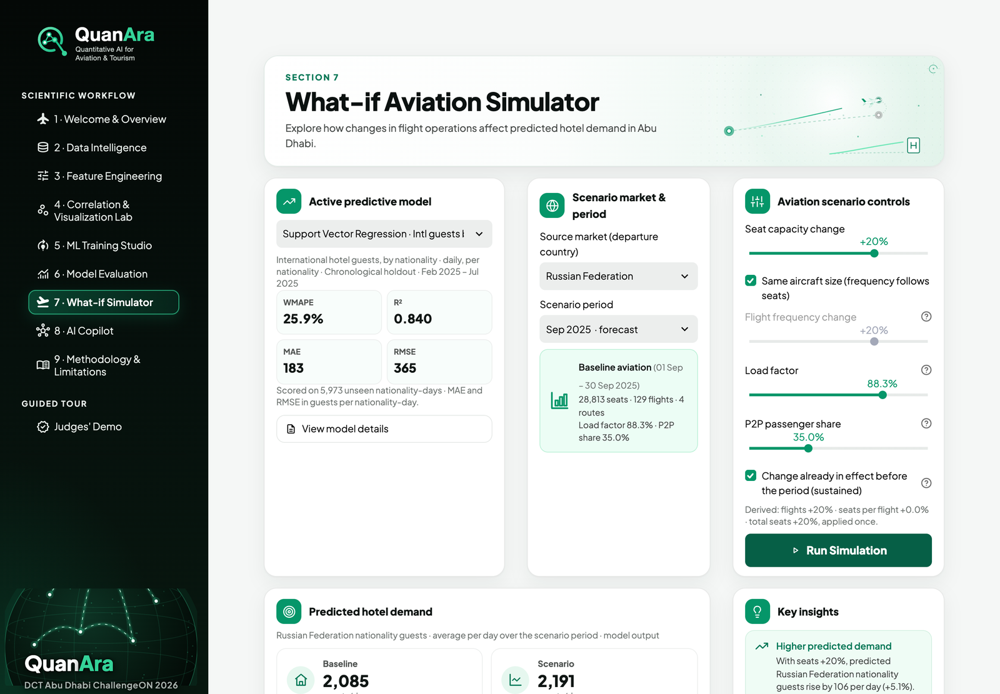

## Application pages

| # | Page | Module |
|---|---|---|
| 1 | Welcome & Overview | `quanara/ui/overview.py` |
| 2 | Data Intelligence | `quanara/ui/data_intel.py` |
| 3 | Feature Engineering | `quanara/ui/features_page.py` |
| 4 | Correlation & Visualization Lab | `quanara/ui/eda.py` |
| 5 | ML Training Studio | `quanara/ui/training_page.py` |
| 6 | Model Evaluation | `quanara/ui/evaluation_page.py` |
| 7 | What-if Simulator | `quanara/ui/simulator.py` |
| 8 | AI Copilot | `quanara/ui/copilot_page.py` |
| 9 | Methodology & Limitations | `quanara/ui/methodology.py` |
| — | Judges' Demo | `quanara/ui/demo.py` |

## Figures

Existing figures and application screenshots from the supplied research package.


Application home page.

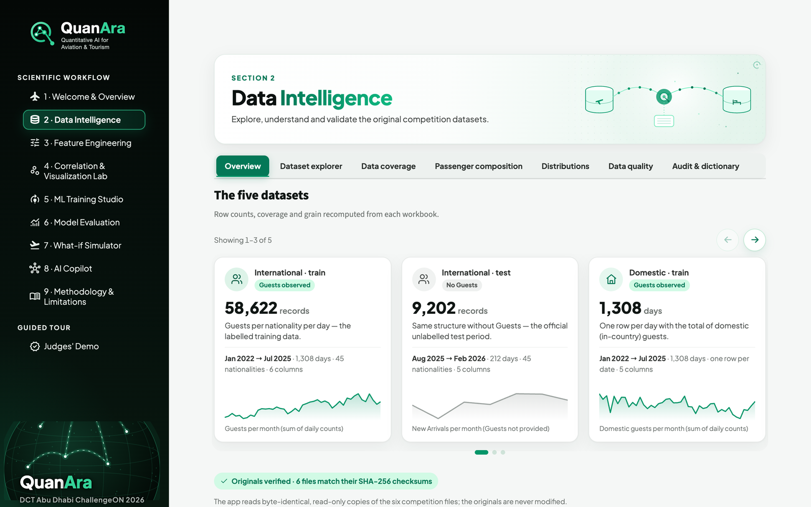

Data Intelligence page: dataset cards.

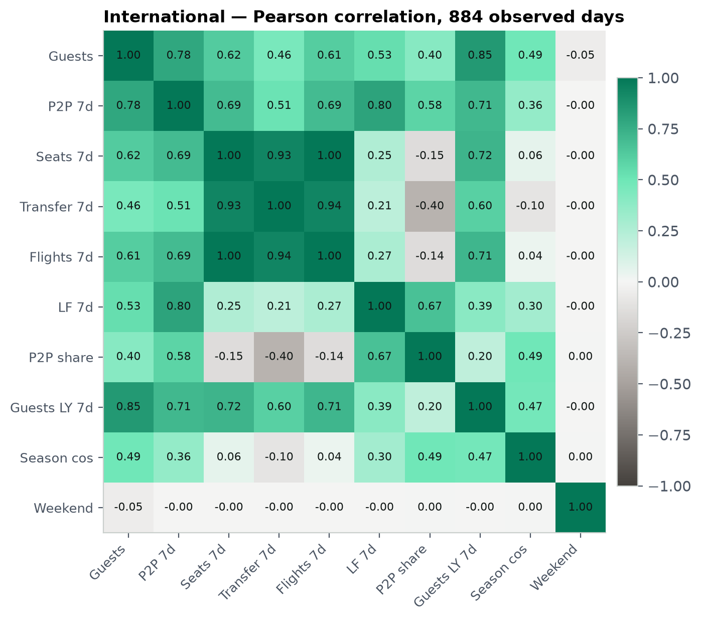

Pearson correlation heatmap for international guests.


7-day P2P arrivals versus international guests.

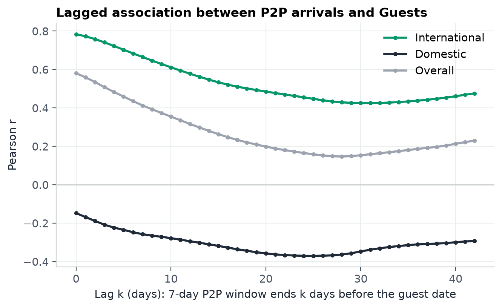

Lagged correlation of P2P arrivals with guests.

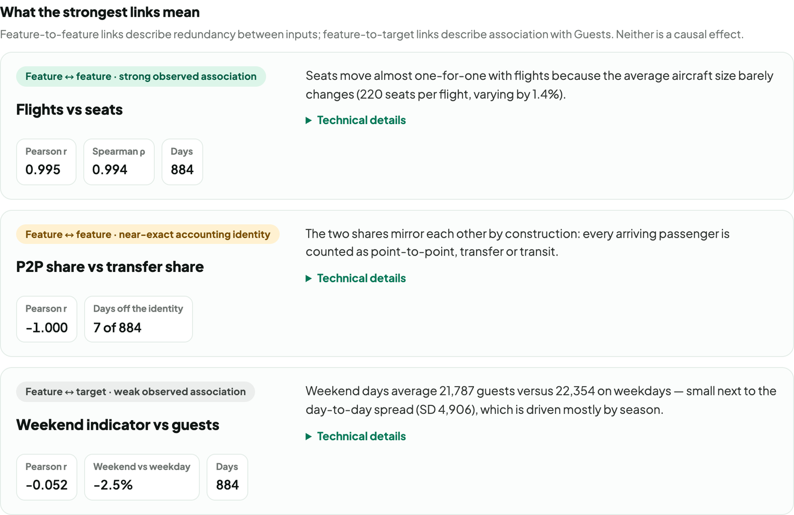

Correlation Lab: interpretation of the strongest links.


Model benchmark at nationality level.

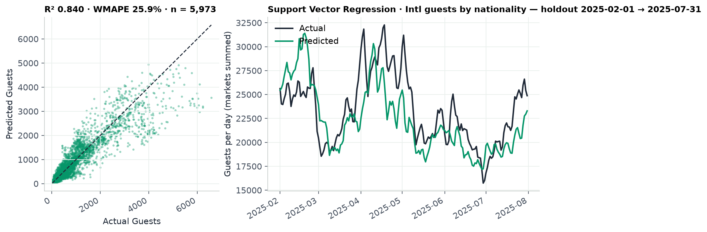

SVR actual versus predicted guests.

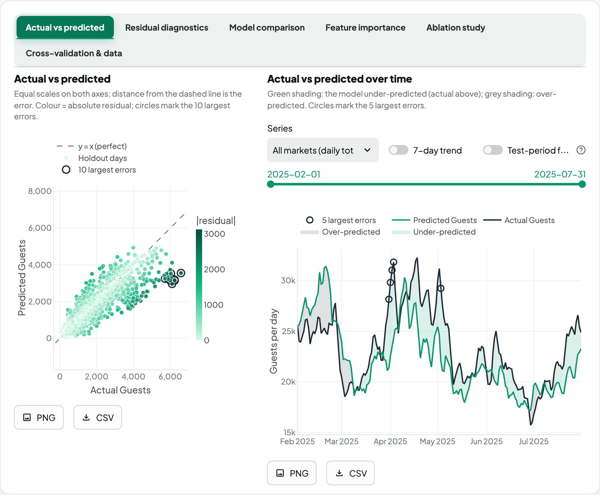

Model Evaluation page.


What-if Simulator.

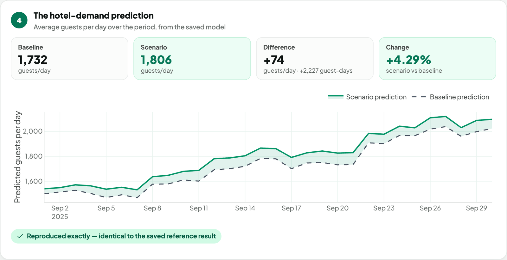

Judges' Demo result.

## Scientific limitations

Summary — full discussion in [`docs/scientific_limitations.md`](docs/scientific_limitations.md):

- **Association, not causation.** Flights and hotel demand share drivers (season, events, growth) and airlines schedule capacity where they expect demand.
- **Departure country ≠ nationality.** 33 of 45 nationalities match a departure country by name (92.2% of guest-days); passengers from a country are not all its nationals.
- **No observed target in the test files**; accuracy is measured on held-out training months only.
- **Autocorrelation** makes classical p-values far too optimistic.
- **Tree models predict flat beyond the training range**, so large scenario changes are understated; extrapolation is flagged.
- **Length of stay is not in the files**, so guest nights cannot be derived (guest-days are reported).
- **Domestic guests** have no direct inbound-flight mechanism; their models' scenario responses reflect seasonal co-movement.

## Future research

Clearly future work, not implemented: a controlled forecasting benchmark comparing these baselines with time-series foundation models and suitably interfaced general-purpose AI models under one protocol; weather-aware and event-aware features; and uncertainty-aware scenarios (prediction intervals, model disagreement, robustness tests).

## Repository structure

```text
app.py                      Streamlit application entry point
quanara/                    Scientific core: data, features, models and scenarios
  ui/                       Nine application pages and the Judges' Demo
data/                       Private-input placement, checksums and schemas
features/                   Feature definitions, matrix builder and checks
models/                     Six algorithm workflows and the saved-model registry
analysis/                   Correlations, plots and statistical diagnostics
evaluation/                 Metric recomputation, comparison and residual checks
simulator/                  Command-line What-if engine and validation
results/                    Aggregate analysis and scenario outputs
figures/                    Scientific charts generated by the scripts
docs/                       Methodology, research documentation and images
reports/                    Data audit, field dictionary and verification records
scripts/                    Dataset, audit, training and documentation workflows
tests/                      Automated scientific and application tests
.streamlit/config.toml      Streamlit configuration
```

## Installation and execution

Requires Python 3.13 (the versions in `requirements.txt` are the verified ones).

```bash
python3 -m venv .venv
.venv/bin/pip install -r requirements.txt
```

Place the six competition files in `data/raw/` (see `data/README.md`) and check them:

```bash
cp data/SHA256SUMS.txt data/raw/ && (cd data/raw && shasum -a 256 -c SHA256SUMS.txt)
```

The trained pipelines are not distributed. Copy your local `artifacts/` folder into the project, or rebuild the 27 reference models and their ablation studies (seed 42; the recorded fitting time of the reference models is about 12 minutes, most of it the SVR market model):

```bash
.venv/bin/python scripts/train_reference_models.py
```

Run the application:

```bash
.venv/bin/streamlit run app.py
```

Reproduce the analysis (each script prints a summary and writes to `results/` and `figures/`):

```bash
.venv/bin/python features/feature_validation.py
.venv/bin/python features/build_features.py --scope international_total --mode whatif
.venv/bin/python analysis/pearson_correlation.py
.venv/bin/python analysis/spearman_correlation.py
.venv/bin/python analysis/correlation_heatmaps.py
.venv/bin/python analysis/scatter_plots.py
.venv/bin/python analysis/statistical_diagnostics.py
.venv/bin/python evaluation/evaluate_models.py
.venv/bin/python evaluation/compare_models.py
.venv/bin/python evaluation/prediction_diagnostics.py
.venv/bin/python simulator/scenario_validation.py
.venv/bin/python simulator/scenario_engine.py --market "RUSSIAN FEDERATION" --month 2025-09 --seats 20
```

Per-model workflows (example: CatBoost; every algorithm folder has the same three scripts):

```bash
.venv/bin/python models/catboost/evaluate.py
.venv/bin/python models/catboost/predict.py --start 2025-08-01 --end 2026-02-28
.venv/bin/python models/catboost/train.py --from MKT-WI-catboost-20261010-123103-7d603b --dry-run
.venv/bin/python models/catboost/train.py --from MKT-WI-catboost-20261010-123103-7d603b --no-save
```

Tests and documentation:

```bash
.venv/bin/python -m pytest -q
.venv/bin/python scripts/build_research_docs.py
```

## Reproducibility notes

- All six source files are verified by SHA-256 before use; the app never writes to them.
- Every displayed metric is recomputed from saved predictions; `tests/test_legacy_artifacts.py` reloads every saved pipeline and reproduces its holdout predictions.
- Re-fitting was not re-run when this package was assembled. `train.py --from <model_id> --no-save` refits a recorded configuration in memory and prints recorded and new metrics side by side.
- **Legacy internal identifiers.** The Python package was renamed twice during development (`aerostay` → `quanterra` → `quanara`). Saved pipelines pickled under the earlier names load unchanged through `quanara/_legacy.py`; these names never appear in the interface.
